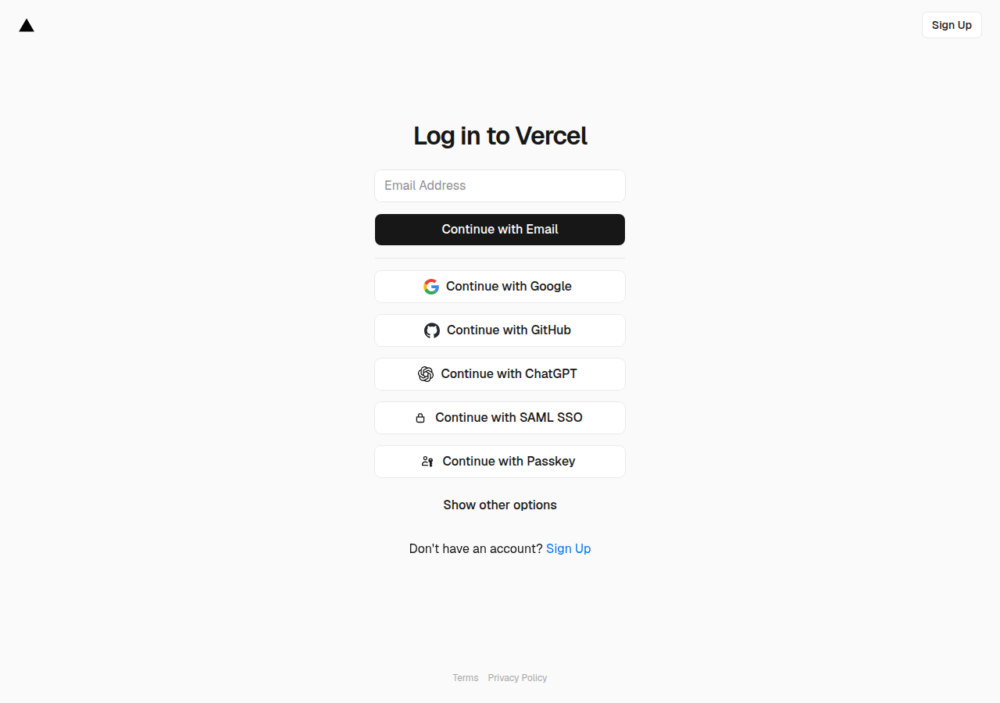

# AI PM 실제 GPT 리뷰 E2E — 2026-10-28

판정: **BLOCKED**

검증 대상 코드는 `19e8fccaed596540979de134bf6e32a981fa3586`이다. `a4f5e96e`와 이 문서의 이후 증거 커밋은 검증 SHA가 아니다. `ee5704c0` Preview는 사용하지 않았다. Production 잠금 `0b465226`과 PR #207 미병합은 유지했다. GPT 호출은 0회다.

## 인증 경로 전환 — 2026-10-28 05:16 KST

인증 없는 브라우저로 Preview를 다시 열지 않았다. Vercel 보호 설정은 해제하지 않았다. 제품 코드는 수정하지 않았다.

| 경로 | 판정 | 시각 | 결과 |
|---|---|---|---|
| 1. 이 런의 `vercel login` | **BLOCKED** | 2026-10-28 05:15 KST | `VERCEL_TOKEN` 없음. `vercel login --non-interactive`는 세션을 만들지 못하고 대기만 했다. 로그인은 끝내지 않았다. |
| 2. CEO 브라우저 리뷰 후 Supabase 조회 | **BLOCKED** | 2026-10-28 05:15 KST | `ai_pm_reviews` HTTP 200, `content-range */0`, 행 0. 리뷰 ID 없음. |
| 3. 두 경로 모두 불가 | **BLOCKED** | 2026-10-28 05:16 KST | 이 런에서는 인증을 만들 수 없다. 인증된 것으로 기록하지 않는다. |

`/api/build-info` SHA, 모델 응답, `nextQuestion`, UI 일치는 경로 1·2가 열리기 전에는 확인하지 않는다.

남은 인증 작업과 담당:

1. 담당 CEO. 이미 Vercel에 로그인된 브라우저에서 `https://ai-startup-validation-qrexjkphr-jyp-ai1s-projects.vercel.app` 를 열고, SHA `19e8fccaed596540979de134bf6e32a981fa3586` 화면에서 주인집 AI PM 리뷰를 1회 실행한다.
2. 담당 CTO. 그 실행 뒤에 `ai_pm_reviews`를 다시 읽어 리뷰 ID, `nextQuestion`, 저장·재조회를 기록한다. UI 일치와 새로고침은 그 브라우저 화면이 있어야 판정한다.

## 이전 확인 — 2026-10-28 05:05 KST

## 1. Preview URL과 SHA

| 항목 | 값 |
|---|---|
| 대상 URL | `https://ai-startup-validation-qrexjkphr-jyp-ai1s-projects.vercel.app` |
| 대상 SHA | `19e8fccaed596540979de134bf6e32a981fa3586` |
| 배포 | GitHub Preview `7359956577`, success, 2026-10-27 22:37 KST |
| 이 런의 `GPT_API_KEY` | 없음. 값은 기록하지 않음 |
| Vercel CLI | `vercel whoami` → Logged out |
| 브라우저 쿠키 | Chrome Cookies 0건 |
| Vercel MCP | 이 런에 없음 |

## 2. 단계별 결과

| 단계 | 판정 | 근거 |
|---|---|---|
| A. Preview 빌드 확인 | **BLOCKED** | `/api/build-info` JSON 요청 HTTP 401 `Protected deployment`. 앱 SHA를 읽지 못함 |
| B. GPT 실제 호출 1회 | **BLOCKED** | A에서 중단. 호출 0회. 모델명, `nextQuestion`, `model-review` 없음 |
| C. Supabase 저장·재조회 | **BLOCKED** | `ai_pm_reviews` HTTP 200, `content-range */0`, 본문 `[]`. 레코드 없음 |
| D. UI 일치·새로고침 | **BLOCKED** | 앱 화면이 열리지 않음. 고정 질문과 비교하지 못함 |

## 3. 로그

`GET /api/build-info` with `Accept: application/json` at 2026-10-28 05:04 KST:

```json
{
  "error": { "code": "401", "message": "Protected deployment" },
  "message": "Protected by Vercel Authentication",
  "protection": {
    "auto_vercel_auth_redirect": true,
    "password_enabled": false,
    "vercel_auth_enabled": true
  },
  "mcp": "web_fetch_vercel_url via an authorized Vercel MCP connection",
  "access": "vercel curl <deployment-url>"
}
```

인증 콜백 URL과 nonce는 기록하지 않았다. 같은 URL의 화면은 Vercel 로그인 페이지다.



## 4. 하지 않은 일

- 주인집 리뷰 요청을 보내지 않았다.
- 고정 `paid_conversion` 질문을 모델 결과로 기록하지 않았다.
- Deployment Protection을 해제하지 않았다.
- Production에 배포하지 않았다.
- PR #207을 병합하지 않았다.
- 제품 코드를 수정하지 않았다.

## 5. 잔여 차단과 최소 권한

CEO 브라우저의 인증 세션이 이 CTO 런에 없다. 앱 JSON, Preview 런타임의 `GPT_API_KEY` 동작, 모델 응답, 저장 레코드, 화면 일치는 모두 그 세션 없이는 만들 수 없다.

필요한 최소 권한은 다음 중 하나다. 비밀값은 채팅에 붙이지 않는다.

1. 이 런에서 `vercel login`이 끝난 뒤 `vercel curl`로 위 URL의 `/api/build-info`를 읽는다.
2. 이 런에 Vercel MCP를 연결하고 `web_fetch_vercel_url`로 같은 URL을 연다.
3. 이 런의 브라우저에 Vercel 로그인 쿠키가 있다.

그 다음에만 주인집 1회, Supabase 재조회, 화면 비교를 같은 SHA에서 진행한다.
